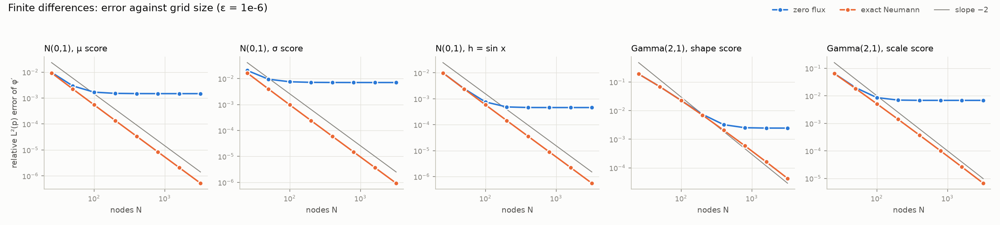
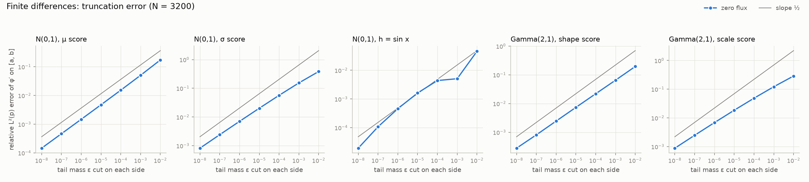
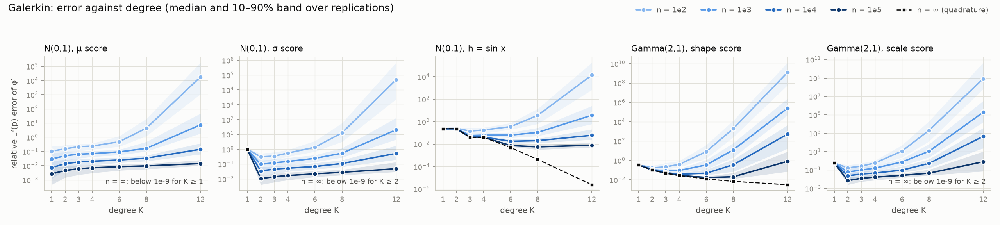
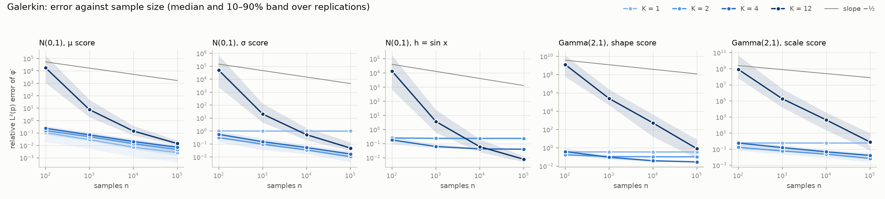

# Pilot results

Results of the pilot defined in [plan.md](plan.md); the methods and the
predicted rates are in [theory.md](../theory.md).

## Setup (C)

- **Problem.** $(p\,\phi')' = h\,p$ on five cases: N(0,1) with the $\mu$
  score, the $\sigma$ score and $h = \sin x$; Gamma(shape 2, scale 1) with the
  shape and scale scores. For a score case $h = -\partial_\theta \log p_\theta$.
- **Error.** Relative $L^2(p)$ error of $\phi'$ against the closed form, on
  $[a, b] = [F^{-1}(\varepsilon), F^{-1}(1-\varepsilon)]$ with
  $\varepsilon = 10^{-6}$.
- **FD.** Conservative scheme on $N$ uniform nodes of $[a, b]$, with zero flux
  at the ends, or with the exact flux there ("exact Neumann", a diagnostic that
  uses the answer).
- **Galerkin.** Hermite polynomials of degree $1..K$ in standardised $x$;
  integrals from $n$ i.i.d. draws, 100 replications; "$n = \infty$" uses
  deterministic quadrature.
- **Run.** `outputs/runs/benchmark_gt/pilot/2026-11-19_pilot/` (commit
  `24448bd`, seed 0, 41 s on a laptop), produced by
  `src/experiments/benchmark_gt/pilot/run_pilot.py`.

## Results (C)

Rows are the cases. Columns are relative errors of $\phi'$: FD at $N = 3200$
for the two boundary conditions; Galerkin with exact integrals at $K = 12$;
and the median Galerkin error over 100 replications at the best degree $K$ for
$n = 10^3$ and $n = 10^5$ (best $K$ in brackets).

| Case | FD zero flux | FD exact Neumann | Galerkin $n=\infty$, $K=12$ | Galerkin $n=10^3$ | Galerkin $n=10^5$ |
| --- | --- | --- | --- | --- | --- |
| `gauss_mu` | 1.5e-3 | 5.2e-7 | 6e-16 | 2.9e-2 (1) | 2.6e-3 (1) |
| `gauss_sigma` | 7.0e-3 | 9.3e-7 | 7e-16 | 9.8e-2 (2) | 1.1e-2 (2) |
| `gauss_sin` | 4.6e-4 | 5.6e-7 | 2.4e-6 | 5.8e-2 (3) | 5.6e-3 (8) |
| `gamma_shape` | 2.4e-3 | 4.3e-5 | 3.1e-3 | 8.4e-2 (3) | 1.7e-2 (6) |
| `gamma_scale` | 6.8e-3 | 6.7e-6 | 6e-13 | 6.0e-2 (2) | 7.0e-3 (2) |

The full table is in `outputs/summaries/benchmark_gt/pilot/summary.csv`.

## What the pilot shows (C)

**The closed form is a usable reference.** The quadrature agrees with the
elementary formulas to about $10^{-14}$ relative between the quantiles
$10^{-10}$ and $1 - 10^{-10}$ (unit tests), far below every error above.

**FD is second order, but zero-flux truncation dominates.**

- With exact boundary flux the observed order between $N = 1600$ and $3200$ is
  2.00 for the Gaussian cases and 1.91–1.96 for the Gamma cases. The Gamma
  order approaches 2 slowly because the lower end $a \approx 1.4\cdot10^{-3}$
  is much smaller than the mesh size.
- With zero flux the error stops improving at $N \approx 100$–$400$ and stays
  at $5\cdot10^{-4}$ to $7\cdot10^{-3}$.
- This floor scales like $\sqrt{\varepsilon}$, not $\varepsilon$: each factor
  100 in $\varepsilon$ gains about one decade (second figure). For `gauss_mu`
  the floor is $\sqrt{2\varepsilon} = 1.4\cdot10^{-3}$, observed
  $1.5\cdot10^{-3}$.
- So at the agreed $\varepsilon = 10^{-6}$ the grid sweep says little about
  zero-flux FD beyond $N = 400$.

**Galerkin error is dominated by Monte Carlo noise.**

- With exact integrals the basis error is zero when $\phi'$ is linear, decays
  fast for `gauss_sin` ($2.4\cdot10^{-6}$ at $K = 12$) and slowly for
  `gamma_shape` ($3.1\cdot10^{-3}$ at $K = 12$).
- With samples, the best median error at $n = 10^5$ is $3\cdot10^{-3}$ to
  $2\cdot10^{-2}$. This is far above the $n = \infty$ line in four cases. The
  exception is `gamma_shape`, where the basis error at the best degree
  ($1.2\cdot10^{-2}$ at $K = 6$) is of the same size as the Monte Carlo error.
- The error decays like $n^{-1/2}$ at fixed small $K$, with a constant that
  grows with $K$, also when the solution is in the span: for `gauss_sigma` at
  $n = 10^5$ it goes from $1.1\cdot10^{-2}$ at $K = 2$ to $4.9\cdot10^{-2}$ at
  $K = 12$.
- The best degree is small and grows slowly with $n$ (1–3 at $n = 10^3$, 1–8
  at $n = 10^5$).
- Large $K$ with small $n$ is unstable: median errors reach $10^4$ for the
  Gaussian and $10^9$ for the Gamma at $K = 12$, $n = 100$.

**Head to head.** At these settings zero-flux FD with 3200 nodes (2 ms per
solve) is 1.5 to 12 times more accurate than Galerkin with $10^5$ samples at
its best degree (9 ms per solve) on `gauss_mu`, `gauss_sigma`, `gauss_sin` and
`gamma_shape`, and equal on `gamma_scale`. The comparison is not like for
like: FD uses the analytic density, Galerkin only the samples.

## Check of the predictions (C)

The predictions P1–P12 are in section 5 of [theory.md](../theory.md). Rows are
the predictions that the saved run can test; "observed" is from that run.

| Prediction | Predicted | Observed |
| --- | --- | --- |
| P1 FD order, exact Neumann, Gaussian | 2 | 2.00 |
| P2 FD order, exact Neumann, Gamma | slightly below 2 | 1.91, 1.96 |
| P3 zero-flux floor at $\varepsilon = 10^{-6}$ (the five cases in table order) | 1.5e-3, 7.0e-3, 4.6e-4, 2.4e-3, 6.8e-3 | 1.5e-3, 7.0e-3, 4.6e-4, 2.4e-3, 6.8e-3 |
| P5 floor against $\varepsilon$ | slope 1/2, modulated by $\lvert\sin b\rvert$ for `gauss_sin` | slope 1/2; kink for `gauss_sin` at $\varepsilon = 10^{-3}$ |
| P7 basis error on the full line, `gauss_sin` $K = 8, 12$ | 5.4e-4, 3.4e-6 | 5.4e-4, 3.3e-6 |
| P7 basis error on the full line, `gamma_shape` $K = 8, 12$ | 7.1e-3, 3.2e-3 | 7.1e-3, 3.1e-3 |
| P9 mean of $n \times$ squared error, `gauss_mu`, $n = 10^5$, $K = 1, 2, 4, 8$ | 2, 3.5, 6.1, 10.7 | 2.1, 3.4, 5.9, 10.6 |
| P9 same, `gauss_sigma`, $K = 2, 4, 8$ | 15, 36, 101 | 15, 37, 111 |
| P10 `gauss_mu`, $K = 1$: median error $\times \sqrt{n}$ | 0.95 | 1.05, 0.92, 0.72, 0.84 for $n = 10^2..10^5$ |
| P11 degree where the $n^{-1/2}$ law breaks, Gaussian | near 6, 8, 8–12 for $n = 10^2, 10^3, \ge 10^4$ | 6–8, 8, 12 |

- The derived predictions (P1, P3, P5, P7, P9) hold to the digits shown.
- P9 fails at large $K$, as P11 says it should: for `gauss_mu` at $K = 12$,
  $n = 10^5$ the observed value is 216 against 15.
- P10 is within the sampling error of a median over 100 replications.
- P6 (slope 1 when the error is measured on a fixed interval) and P8 (the
  condition number for unnormalised Hermite polynomials) are not tested by
  this run.

## Departures from the plan (C)

- **Equilibration.** Before the least-squares solve, the Galerkin system is
  rescaled to a unit diagonal. Under the Gamma the Hermite basis gives
  $\mathrm{cond}(A) = 1.4\cdot10^{15}$ at $K = 12$, and the solve then dropped
  a direction; the rescaled system has condition number $5.5\cdot10^{8}$. The
  span and the exact solution are unchanged. Without it the `gamma_shape`
  reference at $K = 12$ read $7.0\cdot10^{-3}$ instead of $3.1\cdot10^{-3}$.
- **Centred right-hand side.** The basis has no constant, and the sample mean
  of $h$ is not zero, so $\hat b$ depends on the constant offsets of the
  $\psi_k$: monomials and Hermite polynomials then give different solutions.
  Subtracting the sample mean of $h$ removes this. Both variants were run on
  the same draws. The medians agree to within 2% wherever the method is
  stable; they differ only at large $K$, where centring is usually better
  (`gamma_shape`, $K = 12$, $n = 10^5$: 0.80 plain, 0.22 centred). The
  figures and the table use the plain variant, as planned.
- **Reference integrals.** The $n = \infty$ integrals leave out a tail mass of
  $10^{-40}$ instead of $10^{-13}$; the larger value was visible at $K = 12$.

## Open choices (L+C)

**C:** Three points need a decision by L before the pilot is extended.

1. **FD truncation.** Options: a smaller $\varepsilon$ ($10^{-8}$ gives a
   floor of $2\cdot10^{-5}$ to $9\cdot10^{-4}$); solving on a wider interval than the
   one scored; or a boundary condition that models the tail flux. The second
   was tried by the FD sub-agent outside the saved run and gave
   $2\cdot10^{-6}$ to $10^{-4}$ for $\varepsilon = 10^{-8}$ scored on the
   $10^{-6}$ interval.
2. **Default for the centred right-hand side.** C would make it the default,
   since it is the variant that does not depend on the basis offsets.
3. **FD source term in the boundary half cells.** Evaluating $h\,p$ at the
   half-cell centre instead of the end node reduced the Gamma errors by a
   factor 3 to 4 in a scratch test by the FD sub-agent; it is not implemented.
